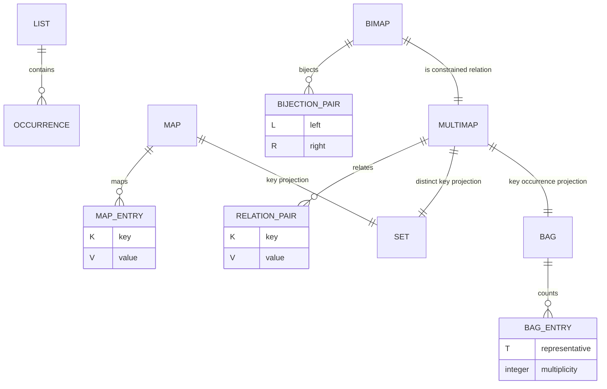
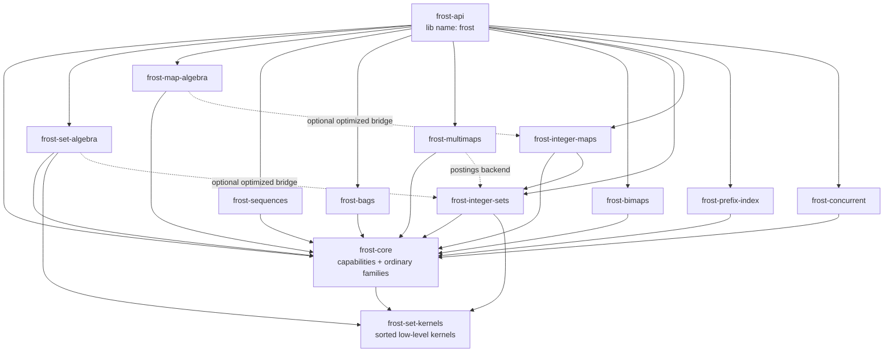

# Algebra and Collection Abstractions for Frost: Maps, Lists, Bags, Multimaps, and Bimaps

## Executive summary

The strongest design direction for Frost is **not a single universal `Collection` algebra**. Sets, maps, sequences, bags, multimaps, and bimaps have genuinely different mathematical laws, conflict semantics, representative rules, and useful physical implementations. Rust’s ecosystem reinforces that separation: `std::collections` distinguishes sequences, maps, and sets; Guava goes further with explicit `Multiset`, `Multimap`, and `BiMap`; functional map libraries expose conflict-combining operations such as Haskell `unionWith`, OCaml `Map.merge`/`Map.union`, and Clojure `merge-with`; FST treats map algebra as set algebra over keys plus an explicit collection of conflicting values. citeturn470474search38turn602131search25turn969676search10turn969676search9turn969676search26turn437300search1

The recommended Frost architecture is therefore **capability-oriented at the read boundary, algebra-specific above it, and backend-specialized below it**. `frost-core` should own fundamental capabilities such as `SetContains`, `MapGet`, entry traversal, cardinality, and stored-representative retrieval. Separate algebra crates should own set expressions, map joins/merges, bag multiplicity algebra, and sequence operations. Specialized crates should remain free to bypass generic execution when they possess stronger structure: sorted arrays can merge linearly, integer sets can execute Roaring/container kernels, FSTs can merge sorted streams, and radix/ART structures can expose prefix/range operations that hash maps cannot. FST already demonstrates that n-ary sorted map operations can run in total linear stream complexity with workspace proportional to the number of streams; Roaring exposes direct cardinality kernels that avoid constructing result bitmaps. citeturn437300search1turn437300search4turn763525view0turn763525view1

The most important semantic issue is **representative identity**. In Rust, two keys can be equal while being distinct stored objects. `HashMap::get_key_value` and `BTreeMap::get_key_value` explicitly support retrieving the actual stored key for this reason. Algebra that returns references therefore has more obligations than algebra that merely computes key membership. Frost should make those rules explicit: on overlapping keys, use the left stored key representative by default; never silently choose a value when both maps contain the key; require a resolver, return both values, or report a conflict. citeturn323218search2turn323218search24

For **bags/multisets**, Frost should distinguish two operations commonly blurred under the word “union”: additive bag sum, where multiplicities add, and max-union, where the multiplicity is `max(a,b)`. C++ `set_union` uses the latter rule for duplicate occurrences, while database `UNION ALL` preserves/adds duplicates rather than eliminating them. Formal bag-algebra literature explicitly warns that bag operations require their own algebraic laws rather than mechanically copying set laws. citeturn602131search21turn637357search1turn557750search8

For **lists**, set vocabulary should generally be avoided. A list is naturally modeled by ordered concatenation—the free-monoid view—not by idempotent union. Rust `Vec` and `VecDeque` expose append/splice/split semantics that preserve sequence position and duplicates; converting a list into a set or bag should be an explicit projection. citeturn799807search3turn389002search3turn389002search0

For **multimaps**, one type is not enough unless its value multiplicity policy is itself a parameter. `K -> Vec<V>`, `K -> Set<V>`, and `K -> Bag<V>` have different laws. The widely used Rust `multimap` crate is specifically a `HashMap<K, Vec<V>>` style abstraction: values retain insertion order, duplicate key-value pairs are allowed, and keys are unordered. Guava similarly distinguishes general `Multimap` from `SetMultimap`. citeturn437300search3turn602131search24turn602131search34

For **bimaps**, ordinary union is not closed. Two individually valid partial bijections may have the same left key mapped to different right values, or different left keys mapped to the same right value. Rust’s `bimap` crate exposes this directly: insertion may overwrite a left pair, a right pair, or both, and an insertion can even reduce cardinality. Frost should therefore make `try_union`, `try_insert`, conflict-resolving merge, and relation-valued union distinct operations rather than pretending bimap union behaves like set union. citeturn437300search0turn323218search0turn323218search1

My recommended long-term public surface is:

| Public Frost domain | Mathematical model | Primary generic operations | Suggested owner |
|---|---|---|---|
| `frost::set` | finite subset | union, intersection, difference, XOR | `frost-set-algebra` |
| `frost::map` | finite partial function `K ⇀ V` | merge, join, difference-by-key, projection | `frost-map-algebra` |
| `frost::seq` | finite ordered sequence | concat, zip, product, merge-sorted, transform | `frost-sequences` |
| `frost::bag` | finite-support `T → ℕ` | sum, max-union, min-intersection, subtract, abs-diff | `frost-bags` |
| `frost::multimap` | relation or `K → Collection<V>` | pair algebra, group-by, joins, projections | `frost-multimaps` |
| `frost::bimap` | finite partial bijection | lookup both ways, intersection, difference, checked merge, composition | `frost-bimaps` |
| `frost::index::prefix` | prefix/radix relation | exact, prefix scan, matching prefixes, longest prefix | `frost-prefix-index` |

The API facade should remain **`frost-api` with library name `frost`**. Concrete implementation crates own concrete types; the facade curates reexports. Algebra crates should depend on capabilities, not on the facade.

## Algebraic foundations and semantic contracts

The useful unifying idea is not “every collection supports union.” The useful unifying idea is that every abstraction has a **logical model**, and an implementation is correct when its observable operations refine that model.

A set is a characteristic function `T → {0,1}`. A bag is a finite-support function `T → ℕ`. A map is a finite partial function `K ⇀ V`. A set-valued multimap is a binary relation `K × V`; sequence- and bag-valued multimaps add ordering or multiplicity to that relation. A bimap is a partial bijection, meaning both projections are functional. A list is a finite word over an alphabet and naturally carries concatenation as an associative operation with the empty list as identity. This list/free-monoid correspondence is standard algebraically, while bag theory can be viewed as a commutative multiplicity structure rather than an ordered sequence. citeturn799807search3turn799807search49turn557750search8

Codd’s relational model is especially useful for reasoning about multimaps and joins. Relations support projection, restriction, and join independently of their physical representation; this separation between logical relation and stored index is exactly the distinction Frost should preserve between `MapJoin`/`MultiMapJoin` and a hash/tree/FST/radix backend. Codd also emphasizes that projection removes duplicate tuples in classical relational algebra, whereas later database practice introduced bag semantics explicitly. citeturn557750search9turn557750search2

Bag semantics change algebraic identities. Joseph Albert’s VLDB treatment formalizes bags as first-class data values and studies which algebraic transformations remain valid under duplicate-sensitive semantics; this is directly relevant to any optimizer Frost eventually adds. SQL likewise makes duplicate behavior syntactically visible: PostgreSQL `UNION`, `INTERSECT`, and `EXCEPT` eliminate duplicates by default, while the `ALL` variants preserve multiplicities. citeturn557750search8turn637357search1turn637357search19

A useful canonical definition for Frost bags is:

| Operation | Multiplicity of element `x` |
|---|---:|
| `sum(A,B)` | `a(x) + b(x)` |
| `max_union(A,B)` | `max(a(x), b(x))` |
| `intersection(A,B)` | `min(a(x), b(x))` |
| `difference(A,B)` | `a(x).saturating_sub(b(x))` |
| `symmetric_difference(A,B)` | `abs_diff(a(x), b(x))` |
| `contains(x)` | `a(x) != 0` |
| `count(x)` | `a(x)` |

Calling both the first two operations `union` would make the API ambiguous. C++’s sorted `set_union` uses the `max` multiplicity behavior, whereas concatenating two bag streams or SQL-style `UNION ALL` gives additive multiplicity. Frost should name the distinction rather than rely on documentation footnotes. citeturn602131search21turn637357search1

Maps require a different table because values create conflicts:

| Key state | `merge_with` | `inner_join` | `difference_by_key` | `symmetric_difference_by_key` |
|---|---|---|---|---|
| left only | left entry | absent | left entry | left entry |
| right only | right entry | absent | absent | right entry |
| both | resolver decides value | return both values | absent | absent |

This is why the functional-language design of supplying a function at the conflict site is so durable. Haskell exposes `unionWith` and `unionWithKey`; OCaml goes further with `Map.merge`, whose callback receives the key and optional values from each side; Clojure offers `merge-with`; Java `Map.merge` supplies a remapping function for an existing value and incoming value. These designs all make the overlap policy explicit instead of pretending there is a uniquely correct map union. citeturn969676search10turn969676search9turn969676search26turn602131search0

For Frost, `inner_join` should generally **not** collapse two values. Its natural borrowed result is:

```rust
(&K, &VL, &VR)
```

whereas `merge_with` intentionally produces one output value. This separation mirrors relational algebra: joining preserves columns from both inputs; projection or an explicit resolver performs reduction. citeturn557750search2

Representative identity is a second dimension separate from equality. Consider:

```rust
#[derive(Hash, Eq, PartialEq)]
struct Key {
    logical_id: u64,
    // Imagine equality intentionally depends only on logical_id.
    display: String,
}
```

Two equivalent keys can carry different non-key metadata. Rust’s standard maps explicitly provide `get_key_value` to recover the stored `&K`, including cases where a lookup key is equal but not identical to the stored object. B-tree maps make the same distinction. citeturn323218search2turn323218search24

The recommended representative rules are therefore:

| Abstraction/operation | Representative rule |
|---|---|
| Set intersection | left stored representative |
| Set union overlap | left stored representative |
| Map inner join | left stored key + both values |
| Map merge overlap | left stored key; resolver chooses/creates value |
| Map difference | left key and value |
| Bag operation, element present on left | left representative |
| Bag result present only on right | right representative |
| Set multimap pair intersection | left key and left value representatives |
| Bimap intersection | left pair representatives |
| Sequence operations | occurrence identity and input position are preserved; no equivalence collapse unless explicitly requested |

This rule is a design recommendation inferred from Rust’s stored-key APIs and Frost’s already-developed left-representative set semantics. It gives deterministic borrowed results without forcing `Clone`.

A compressed bag introduces a subtle limitation. If five equal but physically distinct objects were inserted and the representation stores one object plus count `5`, it cannot later yield five distinct references representing the original occurrences. A bag therefore models **logical multiplicity**, not occurrence identity. Users needing distinct equal occurrences should use a sequence or sequence-valued multimap instead.

Bimap algebra has a particularly important closure property. Pairwise intersection and pairwise difference of two partial bijections remain partial bijections. Union and symmetric difference do not necessarily remain partial bijections:

```text
A = { alice ↔ 1 }
B = { alice ↔ 2 }

A ∪ B = { alice ↔ 1, alice ↔ 2 }   // not a bimap
```

and:

```text
A = { alice ↔ 1 }
B = { bob   ↔ 1 }

A △ B = { alice ↔ 1, bob ↔ 1 }     // not a bimap
```

The behavior of Rust’s `bimap` insertion API—where left conflicts, right conflicts, and simultaneous two-sided conflicts are distinct—is strong practical evidence that this invariant deserves an explicit error model. citeturn323218search1turn323218search3

## Rust ecosystem and cross-language evidence

Rust’s standard library deliberately exposes collection-specific APIs instead of a deep common collection trait hierarchy. `HashMap` provides the `Entry` API and arbitrary traversal order; `BTreeMap` provides ordered traversal; `Vec` exposes splice/dedup/retention; `VecDeque` exposes queue-oriented front-to-back order. This favors Frost’s capability-trait approach over attempting a Java-style inheritance tree. citeturn470474search38turn470474search12turn323218search24turn389002search3turn389002search0

The major Rust crates reveal several distinct useful contracts:

| Rust source | Logical abstraction | Ordering / algebra observations | Design lesson for Frost |
|---|---|---|---|
| `std::HashMap` | unique-key map | arbitrary iteration; borrowed lookup; stored key recoverable | hash capability should not imply stable order |
| `std::BTreeMap` | unique-key ordered map | key-order traversal; stored key recoverable | ordered traversal is a separate capability |
| `hashbrown::HashMap` | unique-key hash map | low-level raw-entry control; hash invariants must be maintained | optimization hooks must remain backend-specific |
| `indexmap::IndexMap` / `IndexSet` | insertion-ordered hash collections | iteration order follows insertion/removal history; set operations preserve defined index order | “ordered” is not the same as key-sorted |
| `imbl::HashMap` | persistent HAMT map | persistent, structurally shared; predictable hash-derived traversal | persistence belongs to storage, not algebra |
| `imbl::OrdMap` | persistent B+ tree map | sorted keys; logarithmic operations | sorted persistent backend can specialize merge |
| `fst::Map` | sorted byte-string → `u64` static map | lexicographic streaming, n-ary key set ops, all conflicting values exposed | exemplary map-algebra stream API |
| `roaring::RoaringBitmap` | integer set | sorted integer iteration, direct cardinality kernels, rank/select | specialized execution should bypass generic iteration |
| `multimap::MultiMap` | `K → Vec<V>`-like multimap | duplicate pairs allowed; values insertion-ordered; keys unordered | multimap value policy must be explicit |
| `bimap::BiHashMap` / `BiBTreeMap` | bijection | two indices; conflict can occur from either side | union requires checked/global conflict handling |
| `multi_bimap` | many-to-many relation | implemented using antiparallel multimaps | relation model is the natural generalization |

Sources: Rust std, hashbrown, indexmap, imbl, FST, Roaring, multimap, bimap, and multi_bimap documentation. citeturn323218search2turn323218search24turn470474search1turn470474search0turn470474search3turn470474search2turn437300search1turn763525view0turn437300search3turn437300search0turn437300search5

`hashbrown` is particularly relevant for Frost’s optimizer boundary. Its raw-entry APIs permit custom lookup and hash reuse, but its documentation explicitly warns that callers must preserve consistency between hashes and keys and that higher-level entry APIs should be preferred where possible. Generic Frost algebra should therefore use safe capabilities by default and expose backend-specific optimized kernels behind trusted implementation boundaries rather than making raw hash manipulation part of the public algebra contract. citeturn470474search1

`indexmap` demonstrates why a single `OrderedElements` trait is too vague. `IndexSet` has a consistent order determined by insertion/removal history, and its set-operation iterators preserve defined concatenated/index order, but this is not sorted order. A merge algorithm requiring ascending keys therefore needs a `SortedEntries`-style capability, not merely “stable iteration.” citeturn470474search0turn323218search8

`imbl` demonstrates the other major storage axis: persistence. Its `HashMap` is HAMT-based; its `OrdMap` is B+tree-based; the library explicitly presents these as immutable persistent data structures. HAMTs originate in Bagwell’s hash-array-mapped trie work, which indexes progressively through hash bits rather than resizing a flat hash table. citeturn470474search3turn470474search4turn557750search11

FST is arguably the best existing Rust precedent for Frost map algebra. Its `Map::op()` accepts multiple map streams and supports union, intersection, difference, and symmetric difference over **keys**. At each output key it supplies `IndexedValue` entries identifying the originating map and associated `u64` value, leaving value conflict resolution to the caller. The operations are documented as `O(n1 + n2 + …)` with memory proportional to the number of streams. citeturn437300search1turn437300search6turn437300search7

Roaring shows why terminal-specific execution matters. The Rust implementation exposes `intersection_len`, `union_len`, `difference_len`, and `symmetric_difference_len` specifically to compute cardinality without building a result bitmap; it also exposes rank/select and guarantees ascending iteration. A Frost query planner should preserve that distinction: `count()` and `iter()` need not share the same physical plan. citeturn763525view0

Cross-language design reinforces the same themes:

| Ecosystem | Important design | Relevance |
|---|---|---|
| C++ | `map::merge` / `unordered_map::merge` splice transferable nodes; multimap/multiset are separate types | consuming merge can reuse storage and must distinguish unique vs duplicate keys |
| C++ algorithms | `set_union` uses max duplicate multiplicity | validates naming distinction for bags |
| Java `Map` | `merge`, `compute`, `computeIfAbsent` explicitly resolve missing/present states | useful model for mutation APIs |
| Java Guava | `Multiset`, `Multimap`, `SetMultimap`, `BiMap` are distinct abstractions | strong evidence against a universal collection algebra |
| Haskell | immutable `Map`, `unionWith`, `unionWithKey` | pure merge-with is a first-class map primitive |
| OCaml | `Map.merge` receives `key`, left option, right option | closest model for a total map-algebra callback |
| Clojure | `merge-with` applies a combiner on conflicts | simple conflict algebra over persistent maps |
| Scala | immutable maps expose `updatedWith` and concatenation | explicit optional old-state transformation |

Sources: C++ reference, Oracle Java APIs, Guava, Haskell containers, OCaml stdlib, Clojure, and Scala documentation. citeturn602131search13turn602131search14turn602131search21turn602131search0turn602131search25turn969676search10turn969676search9turn969676search26turn969676search24

The C++ node-merge design is especially relevant for **consuming** Frost algebra. `unordered_map::merge` attempts to extract nodes from the source and insert them into the destination, letting non-conflicting storage move rather than cloning values. Rust cannot expose identical node semantics uniformly across unrelated backends, but Frost should leave room for `into_merge` / `append_from` operations that exploit ownership when the concrete representation permits it. citeturn602131search13turn602131search18

Java’s `ConcurrentHashMap` also supplies a useful warning: its remapping computation can be atomic for an individual key, but that does not imply that a traversal or multi-key join represents one globally consistent snapshot. Frost concurrency APIs should therefore separate **atomic per-key mutation** from **snapshot algebra**. citeturn602131search6

## Abstraction-by-abstraction design

A **map** should be treated as a keyed relation with one value per equivalence class of key. Its core generic read capability should recover both stored key and stored value:

```rust
pub trait MapGet<Q: ?Sized> {
    type Key;
    type Value;

    fn get_key_value(&self, query: &Q)
        -> Option<(&Self::Key, &Self::Value)>;
}
```

This matches Rust’s own distinction between lookup key and stored key. citeturn323218search2turn323218search24

Traversal should be independent:

```rust
pub trait MapEntries {
    type Key;
    type Value;

    type Iter<'a>: Iterator<Item = (&'a Self::Key, &'a Self::Value)>
    where
        Self: 'a;

    fn entries(&self) -> Self::Iter<'_>;
}
```

An ordered specialization can then promise stronger semantics without contaminating the basic capability:

```rust
pub trait SortedMapEntries: MapEntries {
    // Safety is not involved; this is a semantic contract:
    // keys are unique and yielded in ascending key order.
}
```

For map algebra, use typed views and make conflict behavior explicit:

```rust
let joined =
    frost::map::view(&users)
        .inner_join(frost::map::view(&permissions));

for (id, user, permissions) in joined.iter() {
    // borrowed result, no value cloning
}

let merged =
    frost::map::view(&defaults)
        .merge_with(frost::map::view(&overrides), |_key, base, override_| {
            choose(base, override_)
        });
```

A richer resolver should distinguish one-sided and two-sided states only where necessary. OCaml’s option-based `Map.merge` is maximally expressive, but a dedicated `merge_with` that invokes the resolver only for collisions can be cheaper and easier to type. citeturn969676search9turn969676search28

Recommended map operation signatures are conceptually:

```rust
fn merge_with<R, F>(self, rhs: R, resolve: F)
    -> MergeView<Self, R, F>;

fn inner_join<R>(self, rhs: R)
    -> InnerJoin<Self, R>;

fn left_join<R>(self, rhs: R)
    -> LeftJoin<Self, R>;

fn full_join<R>(self, rhs: R)
    -> FullJoin<Self, R>;

fn difference_by_key<R>(self, rhs: R)
    -> MapDifference<Self, R>;

fn symmetric_difference_by_key<R>(self, rhs: R)
    -> MapSymDiff<Self, R>;
```

`merge_with` produces one value per key; joins retain both values. That distinction should survive all backends.

A **list/sequence** should have a different algebra entirely. Rust’s sequence collections emphasize append, splice, split, indexed access, queue behavior, and order-preserving iteration. `VecDeque::append`, for example, moves all elements from one deque to the back of another and documents overflow if the resulting length cannot fit `usize`; `Vec::splice` performs positional replacement. citeturn389002search0turn389002search2turn389002search3

The Frost sequence surface should therefore center on:

```rust
view(&a).concat(view(&b))
view(&a).zip(view(&b))
view(&a).cartesian_product(view(&b))
view(&sorted_a).merge_sorted(view(&sorted_b))
view(&a).map(f)
view(&a).filter(pred)
view(&a).flat_map(f)
```

Do not expose unqualified `union`, `intersection`, or `difference` on arbitrary lists. Those require an equality relation and a duplicate policy and often destroy the defining order/occurrence semantics. Instead expose explicit projections:

```rust
seq.as_set_view()
seq.as_bag_view()
seq.group_by(key_fn)
```

A **bag** needs multiplicity as its primary capability:

```rust
pub trait BagCount<Q: ?Sized> {
    type Count;

    fn count(&self, value: &Q) -> Self::Count;
}
```

Traversal should operate over distinct logical members plus multiplicity rather than repeatedly manufacturing the same reference:

```rust
pub trait BagEntries {
    type Item;
    type Count;

    type Iter<'a>: Iterator<Item = (&'a Self::Item, Self::Count)>
    where
        Self: 'a;

    fn distinct_entries(&self) -> Self::Iter<'_>;
}
```

The main API should name both “union” concepts:

```rust
bag_a.sum(&bag_b);          // multiplicities add
bag_a.max_union(&bag_b);    // multiplicities take max
bag_a.intersection(&bag_b); // min
bag_a.difference(&bag_b);   // saturating subtraction
bag_a.symmetric_difference(&bag_b); // abs difference
```

That naming aligns the mathematical distinction with C++ duplicate-aware set algorithms and database bag semantics instead of overloading one term. citeturn602131search21turn557750search8turn637357search1

A **multimap** needs its multiplicity policy in the type or type name. The Rust `multimap` crate’s semantics—multiple identical key-value pairs, `Vec`-like value insertion order—are different from Guava’s `SetMultimap`, which disallows duplicate key-value pairs. citeturn437300search3turn602131search24

I recommend separate semantic types even if they share implementation machinery:

```rust
SeqMultiMap<K, V>   // K -> ordered sequence<V>
SetMultiMap<K, V>   // K -> set<V>
BagMultiMap<K, V>   // K -> bag<V>
```

The relation-level algebra is cleanest on `SetMultiMap`:

```rust
pairs_union()
pairs_intersection()
pairs_difference()
pairs_symmetric_difference()
```

For `BagMultiMap`, apply bag rules to `(K,V)` pairs or to each per-key bag. For `SeqMultiMap`, union is not mathematically canonical; use `concat_values`, `merge_values_by`, or an explicit sequence policy.

Projection also needs precise names:

```rust
multimap.distinct_keys()     // set-like projection
multimap.key_occurrences()   // bag-like projection
multimap.pairs()             // relation entries
multimap.values_for(&key)    // collection policy retained
```

Guava’s `Multimap::keys()` returning a multiset-like view is a useful precedent: a key’s multiplicity reflects how many key-value pairs it participates in. citeturn602131search34

A **bimap** should be modeled as a constrained relation rather than “a map with a reverse lookup.” The canonical Rust `bimap` crate literally stores two backing maps and has insertion outcomes for left conflicts, right conflicts, pair replacement, and both-sided conflicts. citeturn437300search0turn323218search1

Frost should therefore expose:

```rust
pub enum BiConflict<L, R> {
    Left { existing: (L, R) },
    Right { existing: (L, R) },
    Both {
        left_existing: (L, R),
        right_existing: (L, R),
    },
}

impl<L, R> FrozenBiMap<L, R> {
    pub fn get_by_left<Q>(&self, q: &Q) -> Option<&R>;
    pub fn get_by_right<Q>(&self, q: &Q) -> Option<&L>;

    pub fn try_insert(
        &mut self,
        left: L,
        right: R,
    ) -> Result<(), BiConflict<L, R>>;
}
```

Algebra should distinguish closed from non-closed operations:

```rust
a.intersection(&b);      // returns a bimap
a.difference(&b);        // returns a bimap

a.try_union(&b);         // Result<BiMap, BiMergeConflict>
a.union_relation(&b);    // always valid, returns SetMultiMap/relation
a.compose(&b);           // partial-bijection composition where domains align
```

`compose` is especially natural for bimaps: if `A: L ↔ M` and `B: M ↔ R`, relational composition remains a partial bijection. This is a much more algebraically meaningful operation for bimaps than forcing every set operator onto the type.

The relationship among these domains can be represented as:



This is a conceptual model, not a proposed storage layout.

## Recommended Frost API and crate architecture

The capability split should remain intentionally small. Avoid a giant trait such as `CollectionAlgebra` with dozens of optional methods and bounds such as `Eq + Hash + Ord + Clone`. Rust’s canonical collections require different equality/order capabilities, and specialized structures such as FSTs and Roaring do not even expose stored `&T` objects in the same manner as ordinary maps. citeturn470474search41turn437300search7turn763525view0

A reasonable foundational layer is:

```rust
pub trait Len {
    fn len(&self) -> usize;
}

pub trait SetContains<Q: ?Sized> {
    fn contains(&self, value: &Q) -> bool;
}

pub trait SetGet<Q: ?Sized>: SetContains<Q> {
    type Item;
    fn get(&self, value: &Q) -> Option<&Self::Item>;
}

pub trait MapGet<Q: ?Sized> {
    type Key;
    type Value;

    fn get(&self, key: &Q) -> Option<&Self::Value>;

    fn get_key_value(
        &self,
        key: &Q,
    ) -> Option<(&Self::Key, &Self::Value)>;
}

pub trait BagCount<Q: ?Sized> {
    type Count;
    fn count(&self, value: &Q) -> Self::Count;
}
```

Traversal should remain separate because some structures support lookup without cheap full enumeration, some reconstruct values, and some have lending-stream semantics. FST streams, for example, yield lexicographically ordered byte keys tied to streaming operation rather than exposing a normal `Iterator<Item=&K>` abstraction. citeturn437300search7turn437300search1

`MapMerge` and `MapJoin` are better viewed as algebra-layer extension traits rather than foundational read traits:

```rust
pub trait MapMerge<Rhs>: Sized {
    fn merge_with<F>(
        self,
        rhs: Rhs,
        f: F,
    ) -> MergeView<Self, Rhs, F>;
}

pub trait MapJoin<Rhs>: Sized {
    fn inner_join(self, rhs: Rhs)
        -> InnerJoinView<Self, Rhs>;

    fn left_join(self, rhs: Rhs)
        -> LeftJoinView<Self, Rhs>;

    fn full_join(self, rhs: Rhs)
        -> FullJoinView<Self, Rhs>;
}
```

These can have blanket implementations over sources satisfying the necessary smaller capabilities. That keeps the traits owned by the algebra crate and avoids forcing every backend to manually implement a large operation matrix.

The proposed crate graph is:



The facade depends downward; implementation crates never depend on `frost-api`.

I would **not immediately extract ordinary maps into `frost-maps`** if doing so breaks existing ownership relationships or creates orphan-rule problems. Keep concrete ordinary/adaptive map families in `frost-core` during the first workspace split, as already proposed in the crate-layout work. `frost-map-algebra` can depend on core and provide the expression/query layer. A later `frost-maps` extraction is justified only if the concrete map families acquire enough independent implementation and verification weight.

The new abstraction crates should have strongly scoped ownership:

| Crate | Owns | Does not own |
|---|---|---|
| `frost-core` | read/write capabilities, `Frozen`, ordinary/adaptive concrete collections, native adapter impls | generic expression planners |
| `frost-set-algebra` | typed set views, generic set execution, materialization | integer storage |
| `frost-map-algebra` | merge/join/difference/projection views | map storage representations |
| `frost-sequences` | sequence views, concat/zip/product/merge-sorted | set-style dedup algebra |
| `frost-bags` | bag types/views/count algebra | arbitrary list occurrence identity |
| `frost-multimaps` | sequence/set/bag multimap types and relation algebra | global bimap uniqueness |
| `frost-bimaps` | one-to-one bidirectional maps and checked algebra | many-to-many relation storage |
| `frost-integer-sets` | encoded integer sets, bitmap specialization | arbitrary element algebra |
| `frost-integer-maps` | encoded-key maps | generic map semantics |
| `frost-prefix-index` | radix/prefix indexes | generic map algebra |
| `frost-concurrent` | live capabilities, snapshots, publication | collection-specific algebra |
| `frost-api` | public namespace, feature forwarding, integration examples | concrete implementation logic |

Feature flags should remain additive and backend-specific. A plausible facade surface is:

```toml
[features]
default = ["std"]

std = [
    "frost-core/std",
    "frost-concurrent?/std",
]

serde = [
    "frost-core/serde",
    "frost-bags?/serde",
    "frost-multimaps?/serde",
    "frost-bimaps?/serde",
]

set-algebra = ["dep:frost-set-algebra"]
map-algebra = ["dep:frost-map-algebra"]
bags = ["dep:frost-bags"]
multimaps = ["dep:frost-multimaps"]
bimaps = ["dep:frost-bimaps"]
sequences = ["dep:frost-sequences"]

integer-sets = ["dep:frost-integer-sets"]
integer-maps = ["dep:frost-integer-maps"]

prefix-index = ["dep:frost-prefix-index"]

hashbrown-0_17 = ["frost-core/hashbrown-0_17"]
indexmap-2 = ["frost-core/indexmap-2"]
imbl-7 = ["frost-core/imbl-7"]
fst-0_4 = ["frost-core/fst-0_4"]
roaring = ["frost-integer-sets/roaring"]
```

The exact dependency versions should remain in workspace dependency declarations. The principle is that enabling `map-algebra` should not silently pull in Roaring, FST, concurrency, or persistence.

Overflow contracts should also be domain-specific. A bag’s per-element multiplicity can overflow even when no collection allocation occurs:

```rust
pub enum BagArithmeticError {
    MultiplicityOverflow,
    CardinalityOverflow,
}
```

I recommend checked additive bag operations:

```rust
fn try_sum<R>(
    self,
    rhs: R,
) -> Result<BagSumView<Self, R>, BagArithmeticError>;
```

or, more practically for lazy views, defer overflow to terminals:

```rust
let view = bag_a.sum(bag_b);

let count: Result<u64, MultiplicityOverflow> =
    view.try_count(&x);

let total: Result<u128, CardinalityOverflow> =
    view.try_cardinality();
```

`max_union`, `intersection`, and saturating difference cannot overflow multiplicity if their inputs are representable; additive sum can.

For maps, conflicts are not arithmetic errors and should have their own type:

```rust
pub enum MergeDecision<V> {
    KeepLeft,
    KeepRight,
    Replace(V),
    Remove,
}
```

A borrowed resolver variant can avoid constructing `V` unless replacement is needed.

For bimaps, conflict errors must describe both axes:

```rust
pub enum BiMergeConflict<'a, L, R> {
    Left {
        incoming: (&'a L, &'a R),
        existing: (&'a L, &'a R),
    },
    Right {
        incoming: (&'a L, &'a R),
        existing: (&'a L, &'a R),
    },
    Cross {
        incoming: (&'a L, &'a R),
        left_existing: (&'a L, &'a R),
        right_existing: (&'a L, &'a R),
    },
}
```

This is conceptually similar to the existing Rust `bimap` crate’s `Overwritten` classification, but for a non-destructive checked operation. citeturn323218search1

## Specialized backends, persistence, concurrency, and performance

Generic algebra should establish semantics; backend kernels should establish speed.

For sorted tree/vector inputs, a two-way merge can produce map union/join in `O(n+m)` comparisons. For a hash map, scanning the smaller source and probing the larger is commonly attractive, but the cost model must include capacity and hashing cost rather than only logical length: Rust’s hash collections make no iteration-order guarantee, and hash-table iteration costs reflect the physical table. citeturn470474search41turn470474search12

For ordered maps, `BTreeMap` iterators yield key order and provide logarithmic lookup with amortized constant traversal cost per emitted item, making ordered merge strategies natural. citeturn323218search24

For `IndexMap`, preserving insertion order can matter more than scanning the nominally smaller side. An algebra view promising stable left-first order must choose a different physical plan from an unordered count query. Indexmap explicitly promises collection order based on insertion/removal history rather than hash order. citeturn470474search0turn323218search8

For FST-backed maps, sorted streaming should be first-class rather than adapted through repeated point lookup. FST’s `OpBuilder` already performs n-ary union/intersection/difference/XOR in linear total input complexity and returns every participating value for an overlapping key. Frost can wrap or integrate this directly for byte-string/`u64` maps while mapping its generic semantic operations onto those streams. citeturn437300search1turn437300search6

For prefix indexes, ART is a strong candidate backend rather than a generic map replacement. The original ART paper targets main-memory indexing, adaptively changes node representation to improve cache and space behavior, retains sorted ordering, and supports operations such as range scans and prefix lookup that ordinary hash tables cannot provide efficiently. citeturn557750search10turn557750search3

The public prefix API should express index-specific semantics:

```rust
pub trait PrefixIndex<Q: ?Sized> {
    type Key;
    type Value;

    fn get(&self, key: &Q) -> Option<&Self::Value>;

    fn entries_with_prefix(
        &self,
        prefix: &Q,
    ) -> impl Iterator<Item = (&Self::Key, &Self::Value)>;

    fn matching_prefixes(
        &self,
        query: &Q,
    ) -> impl Iterator<Item = (&Self::Key, &Self::Value)>;

    fn longest_prefix(
        &self,
        query: &Q,
    ) -> Option<(&Self::Key, &Self::Value)>;
}
```

Raw bytes, UTF-8 strings, filesystem components, and bit-prefixes should remain distinct key-domain policies; byte-prefix equality is not automatically semantic path-prefix equality.

For integer-key maps, a powerful immutable representation is **presence bitmap plus values indexed by rank**. Roaring already supplies membership, cardinality, `rank`, `select`, sorted iteration, and set kernels. An immutable `FrozenIntMap<u32,V>` could conceptually store a Roaring bitmap for present keys plus values in key order; key `k` maps to value index `rank(k)-1` when present. This is an inference from Roaring’s published capabilities, not a claim about the current Frost implementation. citeturn763525view0

Such a representation is excellent for frozen read-heavy maps but less attractive for arbitrary mutation because insertion before existing keys can shift value ranks. A mutable builder can use a different representation and freeze into rank-indexed storage.

For integer-valued multimaps/inverted indexes, Roaring posting lists are a natural specialization:

```text
term -> RoaringBitmap<DocumentId>
```

Then relation intersection becomes bitmap intersection per term, group counts use bitmap cardinality, and multi-term AND queries can start with smaller posting lists. Roaring’s own API exposes cardinality-only operations precisely because building materialized results is not always necessary. citeturn763525view0turn437300search19

Persistence should stay orthogonal to the algebra. `imbl` demonstrates HAMT-based persistent hash maps and B+tree ordered maps; persistent views can structurally share unchanged storage while algebra remains defined over logical entries. citeturn470474search3turn470474search2turn557750search11

This leads to three distinct execution choices:

| Workload | Preferred strategy |
|---|---|
| one short query | borrowed/lazy view |
| repeated query over immutable inputs | prepared/indexed plan where measurements justify it |
| materialized new persistent version | backend-native structural-sharing merge |

A lazy expression is not itself persistent storage. Conversely, a persistent map does not automatically provide optimal n-ary algebra.

Concurrency requires a similar separation. Java’s concurrent-map API can make a single `compute`/`merge` invocation atomic for a key, but global operations still need a defined consistency boundary. citeturn602131search2turn602131search6

For Frost, algebra over `LiveMap` should therefore be explicit about whether it is:

```rust
live.get(key)                 // one live observation
live.update(key, f)           // atomic/local operation

let snap = live.snapshot();   // coherent retained state
view(&snap).inner_join(...)   // algebra over snapshot
```

A concurrent bimap is harder still because a single logical insertion updates two indices atomically. The bimap invariant should not be exposed to readers in an intermediate half-updated state. Unless a concrete backend has a proven atomic protocol, publishing immutable bimap snapshots is the safer architecture.

A useful benchmark suite should avoid claiming universal winners and instead expose the crossover points. The following are **benchmark scenarios**, not measured results:

| Benchmark | Hash baseline | Sorted/tree baseline | Specialized target | Critical metric |
|---|---|---|---|---|
| map inner join, equal sizes | scan + probe, expected `O(n)` | merge `O(n+m)` | FST merge | ns/output entry, hashes/comparisons |
| map join, 1:100 skew | scan small + probe large | seek or merge | FST/radix | ns/input + misses |
| map merge with 90% overlap | hash resolver calls | sorted merge | persistent native merge | resolver calls, allocations |
| bag sum | hash count aggregation | sorted count merge | integer count arrays | overflow checks, allocations |
| set-multimap intersection | nested map/set probes | sorted relation merge | Roaring postings | bytes/output pair |
| prefix lookup | poor hash baseline for prefix enumeration | B-tree range | ART/FST | ns/query, cache misses |
| repeated count-only query | repeated scan | reusable ordered plan | Roaring cardinality kernel | allocations and bytes touched |
| persistent merge | rebuild | persistent B+tree/HAMT | backend-native | nodes allocated/shared |

FST’s documented linear n-ary stream behavior and Roaring’s count-only kernels provide concrete specialized baselines worth including. citeturn437300search1turn763525view0

## Migration, verification, and recommended roadmap

The existing Frost split should evolve incrementally rather than relocating every collection type at once. `frost-api`, `frost-core`, `frost-set-kernels`, `frost-integer-sets`, and `frost-concurrent` remain the right initial workspace foundation. The generic set-algebra work belongs in `frost-set-algebra`; the new research suggests introducing the other algebra domains only as their implementations begin.

A migration sequence with minimal architectural churn is:

| Phase | Repository change | Compatibility rule |
|---|---|---|
| foundation | finish current `crates/frost-*` workspace split | preserve `frost::...` through `frost-api` |
| capabilities | normalize `MapGet`, entry traversal, stored-representative access, `BagCount` prerequisites | no algebra dependency in core |
| set algebra | implement `frost-set-algebra` | preserve existing specialized set methods |
| map algebra | add `frost-map-algebra` typed views | existing map families stay in core initially |
| bags | introduce `frost-bags` with explicit multiplicity semantics | do not alias bags to vectors |
| multimaps | introduce `frost-multimaps` with `SeqMultiMap`, `SetMultiMap`, `BagMultiMap` | multiplicity/order policy visible in type |
| bimaps | introduce `frost-bimaps` | no unchecked union that can violate bijection |
| sequences | introduce `frost-sequences` when lazy sequence composition has real consumers | avoid set terminology |
| specialized indexes | implement `frost-integer-maps`, `frost-prefix-index` | specialized query surface remains visible |
| optimization | add backend dispatch/prepared plans | semantic oracle remains generic reference implementation |

No algebra crate should depend on `frost-api`; the facade merely reexports:

```rust
pub mod map {
    pub use frost_map_algebra::{
        view,
        InnerJoin,
        MergeView,
        MapJoin,
        MapMerge,
    };
}

pub mod bag {
    pub use frost_bags::{
        Bag,
        FrozenBag,
        BagCount,
    };
}

pub mod multimap {
    pub use frost_multimaps::{
        SeqMultiMap,
        SetMultiMap,
        BagMultiMap,
    };
}

pub mod bimap {
    pub use frost_bimaps::{
        FrozenBiMap,
        MutableBiMap,
        BiConflict,
    };
}
```

Representative semantics should receive dedicated regression tests, not just equality tests. A key type whose equality ignores a payload is essential:

```rust
#[derive(Debug)]
struct Key {
    id: u32,
    origin: &'static str,
}

// Eq/Hash only by id.
```

Then verify that:

```text
left  has Key { id: 7, origin: "left"  }
right has Key { id: 7, origin: "right" }

inner_join(left,right) yields the left stored key
merge_with(left,right,...) retains the left key representative
difference(left,right) omits it
right-only entries retain right representatives
```

The standard library’s `get_key_value` APIs justify testing this distinction directly. citeturn323218search2turn323218search24

Property testing should encode algebraic laws **per abstraction**, not one shared law suite. `proptest` provides generated property testing with shrinking and regression persistence; QuickCheck remains another established Rust property-testing implementation. citeturn389248search1turn389248search0

The core laws should look like this:

| Domain | Properties worth testing |
|---|---|
| sets | membership laws; idempotence; commutativity where representative semantics permit only membership equivalence; associativity |
| bags | per-element count equations; `sum` associativity/commutativity absent overflow; max/min lattice laws; truncated difference |
| maps | key-domain equations; resolver call count; representative policy; join equals reference relational model |
| lists | concat associativity; empty identity; exact order preservation; zip truncation policy |
| set multimaps | pair-set laws; projection relations; join against naïve nested-loop oracle |
| sequence multimaps | exact per-key occurrence sequence |
| bimaps | uniqueness on both projections after every operation; checked merge conflict completeness |
| prefix indexes | exact lookup equivalence to reference map; prefix answers equal naïve filtering |
| persistent collections | old version unchanged; new version logically correct; sharing is measured separately |
| concurrent collections | snapshot linearization/invariant tests |

Bag laws should be tested against a tiny reference model such as `BTreeMap<T,u64>`. Multimap laws can use a `BTreeSet<(K,V)>` reference for set multimaps. Bimap correctness can use two ordinary maps plus an explicit invariant checker. Expression optimizations should always be differentially compared to these deliberately boring models.

Formal verification is most valuable at small algorithmic kernels and invariant transitions. Kani is a Rust model checker suited to bounded proof harnesses; it can be used for sorted merge kernels, multiplicity overflow paths, rank/index correspondence, and bimap mutation invariants. citeturn389248search10turn389248search28

Loom is appropriate for concurrent publication/update protocols because it explores alternate thread interleavings under modeled synchronization primitives. It should verify the production snapshot/publication helper, not a simplified algorithm that accidentally omits the relevant synchronization. citeturn389248search13turn389248search18

Miri should remain local to crates with unsafe representation work: inline collection buffers, custom radix nodes, rank-indexed storage, or unsafe cursor implementations. Pure algebra crates should generally need property tests and differential models more than their own unsafe-code test infrastructure.

The most useful formal models can be tiny enough to live directly beside the crate. For bags:

```rust
type ModelBag<T> = BTreeMap<T, u64>;
```

For map joins:

```rust
fn model_inner_join<K: Ord, A, B>(
    a: &BTreeMap<K, A>,
    b: &BTreeMap<K, B>,
) -> Vec<(&K, &A, &B)> {
    a.iter()
        .filter_map(|(k, av)| {
            b.get(k).map(|bv| (k, av, bv))
        })
        .collect()
}
```

For bimaps, every mutating test should assert:

```rust
assert_eq!(forward.len(), reverse.len());

for (l, r) in &forward {
    assert_eq!(reverse.get(r), Some(l));
}

for (r, l) in &reverse {
    assert_eq!(forward.get(l), Some(r));
}
```

That simple invariant is more valuable initially than a sophisticated optimizer proof.

The architectural principle that emerges from the research is:

**Capability traits describe what a source can do; algebra crates describe mathematical operations; concrete crates own representation; specialized kernels are selected when stronger capabilities are available; the facade presents one coherent user namespace.**

That separation matches Rust’s collection idioms, functional map-algebra practice, relational and bag theory, and the most capable specialized Rust backends. It also gives Frost room to support arbitrary user-defined keys, strings, bags, map joins, prefix indexes, integer compression, persistence, and snapshots without forcing all of them through one artificial “collection” interface. citeturn470474search38turn969676search10turn557750search8turn557750search2turn437300search1turn763525view0