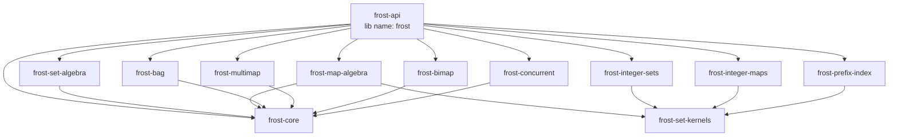
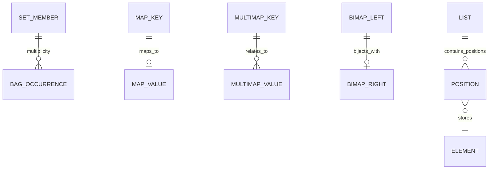

# Frost Collections Research: Map, List, Bag, Multimap, and BiMap Algebra in Rust

## Executive summary

Frost should treat **sets, bags, maps, multimaps, bimaps, and ordered sequences as a family of related but semantically distinct abstractions**, rather than attempting to force them through one universal “collection algebra” trait. Their implementations can share traversal, lookup, representative-recovery, count, materialization, and execution-planning infrastructure, but their algebraic laws differ enough that a single vocabulary such as `union` and `intersection` becomes ambiguous outside ordinary sets.

The most important design principle is that a Rust collection contains **stored representatives**, not merely abstract mathematical values. Two objects can compare equal while carrying different non-key state. A correct algebra therefore has at least four observable dimensions: logical membership, representative selection, traversal order, and ownership/lifetime. The `bimap` crate explicitly documents this issue for equal endpoints carrying different data and exposes overwrite-versus-reject insertion semantics because maintaining a bijection requires resolving conflicts on both sides. citeturn338730view0

For maps, Frost should model algebra over finite partial functions and make value conflicts explicit through operations such as `merge_left`, `merge_right`, `merge_with`, `try_merge_unique`, and joins. The Rust `fst` crate provides a particularly useful precedent: its n-ary map operations merge lexicographically ordered streams and return each key together with the values contributed by participating streams, leaving conflict resolution visible to the caller; its operations run in total input-linear time with workspace proportional to the number of streams. citeturn338730view2

For bags, Frost should model multiplicity explicitly rather than calling a bag “a set with duplicates.” The literature distinguishes different valid union laws, especially sum-based union and maximum-based union, and those choices change which rewrite rules are valid. Joseph Albert’s VLDB work formalized algebraic properties of bag operations, while later database-theory work explicitly distinguishes sum-based from maximum-based bag semantics. citeturn818566search0turn818566search3

For multimaps, the duplicate policy should ideally be represented in the type: a set-valued multimap, bag-valued multimap, and list-valued multimap have observably different semantics. The established `multimap` crate is list-valued per key: it is built around `HashMap<K, Vec<V>>`, preserves value insertion order, permits identical key-value pairs to repeat, and even permits a key with an empty value vector. citeturn338730view1

For lists, Frost should avoid importing set terminology altogether. Rust’s `Vec<T>` is fundamentally an ordered, contiguous sequence with O(1) indexing and amortized O(1) append; sequence algebra is better expressed in terms of concatenation, stable merge, zip, interleave, prefix/suffix, partition, windows, and diff/patch rather than ambiguous “union” or “intersection.” citeturn260828search3turn260828search0

For implementation, Frost should preserve multiple execution profiles. Ordinary maps and sets can lend references to stored objects; Roaring-style integer structures reconstruct values by value; FST-style structures reconstruct keys into cursor-owned buffers and therefore require lending-stream semantics rather than ordinary `Iterator`. The `fst` crate documents this distinction explicitly and explains that its `Streamer` reuses a single key buffer to avoid per-key allocation. citeturn338730view3

The recommended workspace direction is:



The full repository-ready research document and reusable prompt/report template are available here:

[Research document — `docs/research/collection-algebra.md`](sandbox:/mnt/data/frost-collection-algebra-research.md)

[Research template — `docs/research/RESEARCH_TEMPLATE.md`](sandbox:/mnt/data/frost-research-template.md)

## Scope and algebraic foundations

The goal is to give Frost an architecture that can support arbitrary Rust element types without assuming a universal `Clone + Default + Hash + Ord` bound, while still enabling specialized sorted, hash, compressed-integer, FST, prefix-index, persistent, and concurrent implementations. No explicit target restrictions were given, so this research assumes portable Rust as the baseline, with `no_std + alloc`, mmap, SIMD, and platform-specific acceleration treated as optional capabilities rather than universal requirements.

A useful taxonomy is:

| Abstraction | Mathematical model | Canonical operations | Meaning of duplicates | Main semantic hazard |
|---|---|---|---|---|
| Set | finite subset | union, intersection, difference, symmetric difference | absent | equal stored representatives may differ |
| Bag / multiset | finite-support function `T → ℕ` | additive union, max union, min intersection, truncated subtraction | multiplicity is first-class | ambiguous meaning of “union” |
| Map | finite partial function `K ⇀ V` | merge, key difference, joins, projection | one value per key | value collision policy |
| Multimap | finite relation or `K → Collection<V>` | relation union/intersection/difference, per-key merge | set-, bag-, or list-dependent | duplicate and fiber-order policy |
| BiMap | finite partial bijection `L ↔ R` | insertion/removal/inversion, constrained merge | endpoints unique on both sides | two-sided conflict |
| List / sequence | finite ordered word | concat, zip, merge, prefix/suffix, interleave | repeated positions are distinct | position/order dominates equality |

For bags, define the multiplicity of `x` in bag `A` as \(m_A(x)\). Four useful operations are:

\[
m_{A \oplus B}(x)=m_A(x)+m_B(x)
\]

for additive union,

\[
m_{A \sqcup B}(x)=\max(m_A(x),m_B(x))
\]

for maximum union,

\[
m_{A \cap B}(x)=\min(m_A(x),m_B(x))
\]

for intersection, and

\[
m_{A-B}(x)=\max(m_A(x)-m_B(x),0)
\]

for truncated difference.

These are not interchangeable. Bag-semantics literature was developed in part because ordinary set rewrite identities do not automatically carry over when multiplicity is observable. citeturn818566search0turn818566search2turn818566search3

That argues for explicit Frost API names such as:

```rust
let summed = bag(&a).sum(&b);
let covered = bag(&a).max_union(&b);
let common = bag(&a).intersection(&b);
let remainder = bag(&a).difference(&b);
```

rather than one ambiguous `union` whose meaning must be remembered from documentation.

Maps require a similarly explicit treatment. A key union merely establishes which keys appear; it does not tell the implementation what value should be attached to a key that exists in both operands. A generic map algebra should therefore model collisions as an input to the operation:

```rust
let merged = frost::map::view(&left)
    .merge_with(&right, |_key, left, right| {
        match (left, right) {
            (Some(a), Some(b)) if a.priority >= b.priority =>
                Resolution::Left(a),
            (Some(_), Some(b)) =>
                Resolution::Right(b),
            (Some(a), None) =>
                Resolution::Left(a),
            (None, Some(b)) =>
                Resolution::Right(b),
            (None, None) =>
                unreachable!(),
        }
    });
```

FST’s `OpBuilder` is evidence that exposing the participating values is practical rather than purely theoretical: its map union and intersection streams emit a key plus an indexed list of the values contributed by each participating stream. citeturn338730view2

For a multimap, the type should answer whether a repeated pair is meaningful. A `SetMultiMap<K,V>` represents a binary relation where each pair occurs at most once. A `BagMultiMap<K,V>` gives pairs multiplicities. A `ListMultiMap<K,V>` gives each key an ordered sequence of values. The existing `multimap` crate chooses the third model: values are held in vectors, insertion order is preserved, and identical pairs may repeat. citeturn338730view1

For a BiMap, the invariant is:

\[
(l,r_1)\in B \land (l,r_2)\in B \Rightarrow r_1=r_2
\]

and

\[
(l_1,r)\in B \land (l_2,r)\in B \Rightarrow l_1=l_2.
\]

The `bimap` crate implements this with two backing maps and therefore inherits their asymptotic operation class; its API offers both overwrite and no-overwrite insertion because the invariant forces conflict handling to be part of the public contract. citeturn338730view0

The representative problem cuts across all of these abstractions. Suppose equality for:

```rust
struct Record {
    id: u64,
    label: String,
}
```

depends only on `id`. A left map can store `{7, "left"}` while a right map stores `{7, "right"}`. If an intersection returns a borrowed `&Record`, the optimizer cannot arbitrarily return whichever object is easiest to reach. Frost should specify representative semantics independently of logical equality. The bimap documentation contains essentially this same equal-but-different-object case and treats the replacement as observable behavior. citeturn338730view0

A sound default for borrowed Frost algebra is **left-representative preservation** for operations whose result is logically derived from the left source, with explicit conflict resolvers wherever the surviving representative is not obvious.

## Rust ecosystem landscape

The table below treats “maintained” conservatively as a current release/activity signal, not a promise of future support.

| Crate / family | License | Maintenance signal | Borrow semantics | Duplicate support | Specialized implementation | Typical complexity |
|---|---|---|---|---|---|---|
| `std::collections` | MIT OR Apache-2.0 citeturn116162search1 | maintained with Rust | ordinary borrowed iterators | maps/sets unique, sequences repeat | std HashMap is SwissTable-derived; BTree structures ordered | HashMap expected O(1), BTreeMap O(log n), Vec index O(1) citeturn260828search0turn260828search1 |
| `hashbrown` 0.17.1 | MIT OR Apache-2.0 citeturn846237search4 | active 2026 line | std-like | unique keys | SwissTable, SIMD lookup, `no_std + alloc` support | expected O(1) hash access citeturn260828search4 |
| `indexmap` 2.14.2 | Apache-2.0 OR MIT citeturn846237search1 | released Sept. 2026 | borrowed refs plus stable dense indices | unique keys | hash index + dense entry vector | expected hash lookup; dense fast iteration citeturn260828search5turn260828search6 |
| `imbl` 7.0.2 | MPL-2.0+ citeturn846237search2 | released Sept. 2026 | immutable/persistent borrows | unique map/set keys | persistent HAMT/B+ tree/RRB-style structures | ordered map operations mostly O(log n) citeturn260828search7turn260828search8 |
| `fst` 0.4.7 | MIT OR Unlicense citeturn321353search3 | mature; latest published 2021 | lending `Streamer` | unique built keys | minimal FST, mmap-friendly, n-ary merge streams | n-ary algebra O(sum inputs), memory O(stream count) citeturn338730view2turn338730view3 |
| `roaring` 0.11.5 | MIT OR Apache-2.0 citeturn321353search4 | released Aug. 2026 | decoded integer values | set semantics | compressed bitmap containers | specialized bitset/container kernels citeturn771789search2turn818566search9 |
| `bimap` 0.6.3 | MIT OR Apache-2.0 citeturn321353search0 | no recent release | borrowed lookup both directions | endpoint uniqueness | two backing maps | same class as backing maps citeturn338730view0 |
| `bidimap` 0.7.0 | MIT OR Apache-2.0 citeturn321353search1 | released Mar. 2026 | two-way borrowed lookup | endpoint uniqueness | hash/tree bimap variants | backing-map complexity citeturn771789search3 |
| `multimap` 0.10.1 | MIT OR Apache-2.0 citeturn116162search2 | released May 2025 | refs into per-key vectors | identical pairs allowed | `HashMap<K, Vec<V>>` | expected hash-key access plus vector work citeturn771789search0turn338730view1 |
| `multi_bimap` 0.8.0 | MIT OR Apache-2.0 citeturn321353search8 | released Oct. 2026 | container-dependent; cloning/shared-pointer costs explicit | configurable cardinalities | synchronized antiparallel mappings | depends on chosen containers citeturn846237search6 |

Several lessons are especially important for Frost.

**Ordering is not one capability.** `BTreeMap` sorts by key; `IndexMap` preserves an insertion/index order independent of key hashes or values; FST streams are lexicographic byte order. `IndexMap` explicitly documents that its iteration order is independent from hash or key value and can change under particular removal operations. citeturn260828search5 A future Frost trait should therefore distinguish `SortedByKey`, `StableSourceOrder`, and positional sequence order rather than expose a vague `Ordered`.

**Iteration lifetime depends on storage.** Normal maps and sets can return references to stored objects. FST cannot efficiently implement ordinary `Iterator` for reconstructed search keys because those keys borrow from cursor-owned scratch storage; it instead uses a lending `Streamer`. citeturn338730view3 Roaring is different again: the natural result is a decoded integer value, not a reference to a stored `u32`. citeturn968624search16turn771789search2

**Persistence is a storage strategy, not a wrapper.** `imbl` exposes immutable collections whose implementation is designed around persistent structures such as HAMTs, B+ trees, and RRB-style vectors. citeturn260828search7turn846237search2 Frost should benchmark structural-sharing designs separately from ordinary frozen collections rather than treating `Arc<HashMap<…>>` as equivalent persistence.

## Frost architecture and proposed APIs

The public facade should remain `frost-api`, with users importing from the Rust crate name `frost`. Canonical implementation crates should own their types, while the facade reexports selected stable APIs.

A reasonable module surface is:

```text
frost::set
frost::map
frost::bag
frost::multimap
frost::bimap
frost::seq
frost::integer
frost::index::prefix
frost::concurrent
```

Internally, the architecture should prefer small capabilities over one universal trait:

```rust
pub trait Len {
    fn len(&self) -> usize;
}

pub trait Contains<Q: ?Sized> {
    fn contains(&self, query: &Q) -> bool;
}

pub trait Get<Q: ?Sized> {
    type Stored: ?Sized;

    fn get(&self, query: &Q) -> Option<&Self::Stored>;
}

pub trait Entries {
    type Key: ?Sized;
    type Value: ?Sized;

    type Iter<'a>: Iterator<Item = (&'a Self::Key, &'a Self::Value)>
    where
        Self: 'a;

    fn entries(&self) -> Self::Iter<'_>;
}
```

`Contains` and `Get` must remain distinct. An optimizer can use boolean lookup for a count or emptiness query, but representative-preserving borrowed output may require retrieving the actual stored object.

Typed views are preferable as the default composition mechanism:

```rust
use frost::map::view;

let query = view(&base)
    .merge_with(view(&overlay), |_key, base, overlay| {
        match overlay {
            Some(v) => Choice::Right(v),
            None => Choice::Left(base.unwrap()),
        }
    })
    .difference_keys(view(&deleted));

for (key, value) in query.iter() {
    consume(key, value);
}
```

The view type should preserve concrete leaf types rather than erase them prematurely, because a B-tree source, hash source, FST source, Roaring source, and persistent source expose different capabilities and benefit from different physical plans.

For maps, recommend:

```rust
merge_left
merge_right
merge_with
try_merge_unique

inner_join
left_join
full_join

difference_keys
intersection_keys
keys_view
values_view
```

The distinction between map merging and relational joining matters. `merge_with` produces one map value per resulting key; `inner_join` can expose both values without forcing an immediate reduction.

For bags:

```rust
let summed = bag(&a).sum(&b);
let maxed = bag(&a).max_union(&b);
let common = bag(&a).intersection(&b);
let remainder = bag(&a).difference(&b);

let total: Result<u128, CountOverflow> = summed.try_count();
```

A bag storage type can expose both distinct-key count and total multiplicity:

```rust
fn distinct_len(&self) -> usize;
fn try_cardinality(&self) -> Result<u128, CountOverflow>;
```

For multimaps, prefer type-level duplicate policies:

```rust
SetMultiMap<K, V>
BagMultiMap<K, V>
ListMultiMap<K, V>
```

with algebra working on each key’s *fiber*:

```rust
let merged =
    frost::multimap::view(&a)
        .merge_with(&b, |_key, left_values, right_values| {
            frost::set::view(left_values).union(right_values)
        });
```

For BiMap, conflict behavior must be transactional:

```rust
pub enum BiInsertError<L, R> {
    LeftOccupied {
        attempted: (L, R),
    },
    RightOccupied {
        attempted: (L, R),
    },
    BothOccupied {
        attempted: (L, R),
    },
}

pub trait BiMap<L, R> {
    fn get_left<Q: ?Sized>(&self, q: &Q) -> Option<&R>;
    fn get_right<Q: ?Sized>(&self, q: &Q) -> Option<&L>;

    fn try_insert(
        &mut self,
        left: L,
        right: R,
    ) -> Result<(), BiInsertError<L, R>>;
}
```

A separate `insert_overwrite` should return every displaced endpoint rather than discard them. That follows the same explicit philosophy as `bimap`’s overwrite result. citeturn338730view0

Borrowed iteration must preserve representatives:

```rust
for item in frost::set::view(&left)
    .intersection(&right)
    .iter()
{
    // Contract: an equal item comes from `left`,
    // even if the execution plan probes from `right`.
    use_item(item);
}
```

This is where algebraic and physical semantics diverge. “Scan the smaller input” is a performance rule; “return the left representative” is an API rule. An optimizer may use the former only if it has enough capability to satisfy the latter.

The collection relationships can be summarized as:



## Implementation and optimization techniques

Sorted maps and sets should share merge kernels. A binary sorted merge is linear in the two input lengths and can preserve key order without allocation. FST demonstrates that the same principle extends to n-ary lexicographically sorted streams: its map `OpBuilder` performs union, intersection, difference, and symmetric difference across arbitrary stream counts in O(n₁+n₂+…) total work and memory proportional to the number of streams. citeturn338730view2

That suggests extending `frost-set-kernels` with generic sorted-key cursors usable by both set and map algebra. A map cursor can surface collisions as:

```rust
enum KeyRun<'a, K, V> {
    Left(&'a K, &'a V),
    Right(&'a K, &'a V),
    Both {
        key_left: &'a K,
        value_left: &'a V,
        key_right: &'a K,
        value_right: &'a V,
    },
}
```

The resolver then decides which representative and value survive.

Hash kernels should distinguish candidate selection from output provenance. For an `intersection_count`, scanning the smaller side and probing the other is often sensible. For a borrowed `intersection_iter`, scanning the smaller *right* source is useful only if the left source can recover its stored representative with `get`. HashMap costs are expected rather than strict worst-case guarantees, and the standard documentation notes that hashing behavior and table state affect costs. citeturn260828search1turn260828search0

N-ary execution should not simply build a deeply nested binary expression. Better plans include:

| Data profile | Preferred n-ary strategy |
|---|---|
| sorted streams | frontier/heap merge |
| unordered hash sources | temporary exact index or chosen build/probe side |
| integer bitmaps | tree or container-wise AND/OR |
| FST byte strings | native ordered stream operation |
| materialization | use destination as the duplicate/conflict index |
| highly selective intersection | candidate-first probing ordered by selectivity |

Terminal-specific planning should be a first-class concept. `contains`, `is_empty`, exact count, first match, borrowed traversal, and full materialization should not be forced through the same physical plan.

Encoded integer structures should remain specialized. The Rust `roaring` crate is a current pure-Rust compressed bitmap implementation, while the Roaring literature describes container-aware and SIMD-accelerated algorithms for union, intersection, difference, and symmetric difference. citeturn771789search2turn818566search9 Frost should therefore integrate integer maps and bags through value-oriented capabilities rather than pretending their keys are stored as individually borrowable objects.

For a future `frost-integer-maps`, a useful frozen layout is:

```text
presence bitmap
rank directory
dense value array in key order
```

Rank/select research shows that compact indexable dictionaries can support rank and select with very small redundancy and constant-time RAM-model operations, making this an attractive design for static key universes. citeturn809745search0turn809745search1

The critical invariant is that every rank transition still indexes the correct value. Construction should therefore be checked against a straightforward ordered-map model with values that are deliberately non-`Clone`.

Prefix indexing deserves its own profile. FST is compelling for immutable byte-string dictionaries because it can search compressed structures, can be backed by memory-mapped bytes, and exposes lexicographic streaming operations. Its current map values are restricted to `u64`, however, and keys are byte strings. citeturn338730view3

For mutable general-value prefix indexes, ART is a strong candidate. The original Adaptive Radix Tree paper describes adaptive internal node layouts intended to improve cache efficiency while preserving ordered operations, range scans, and prefix lookup. citeturn818566search5turn818566search8

The prefix API should distinguish at least:

```rust
get_exact(query)
entries_with_prefix(prefix)
matching_prefixes(query)
longest_prefix(query)
```

because these are different relations. A byte-prefix index, UTF-8 text index, path-component index, and IP-bit-prefix index must not silently share normalization semantics.

FST also demonstrates the right way to think about zero-copy output. It can memory-map its backing bytes and search without eagerly loading the entire structure, but individual keys may still be reconstructed into a reusable cursor buffer. citeturn338730view3 Frost should therefore document output modes precisely:

| Output mode | Meaning |
|---|---|
| stored borrowed | `&T`, `(&K,&V)` from source storage |
| lending reconstructed | borrow valid until next cursor advance |
| decoded by value | e.g. `u32` from compressed bitmap |
| shared owned | `Arc<T>` or persistent shared node |
| independently owned | cloned or consumed value |

“Zero-copy” should never be used as a substitute for one of these explicit contracts.

## Correctness, verification, and benchmark strategy

Every algebra operation should specify four independent obligations:

**Logical correctness:** the abstract set, bag, mapping, relation, or sequence is correct.

**Representative correctness:** equal stored objects are selected according to the documented source-precedence or resolver rule.

**Traversal correctness:** uniqueness, multiplicity, ordering, and lending lifetime match the API promise.

**Ownership correctness:** borrowed values remain valid, consumed values are moved or dropped exactly once, and failures recover or dispose of inputs according to the documented contract.

This distinction limits optimizer rewrites. Set membership may be associative while representative selection is not. An arbitrary map `merge_with` closure cannot be reassociated merely because key union is associative. Likewise, bag rewrite laws depend on whether combination is additive or max-based; the academic bag-algebra literature explicitly exists to establish which identities remain valid under each semantics. citeturn818566search0turn818566search3

For BiMaps, every mutation must preserve inverse consistency. A simple model is two `BTreeMap`s:

```rust
left_to_right: BTreeMap<L, R>
right_to_left: BTreeMap<R, L>
```

and after each operation assert that the mappings are exact inverses. Panic-injection testing should ensure no partially updated pair of indexes can escape. This is especially important if the implementation uses two separately mutated hash structures, as existing bimap implementations conceptually do. citeturn338730view0

Recommended local verification commands are:

```bash
cargo fmt --all -- --check
cargo clippy --workspace --all-targets --all-features -- -D warnings
cargo test --workspace --all-features
cargo doc --workspace --all-features --no-deps

cargo test -p frost-map-algebra
cargo test -p frost-bag
cargo test -p frost-multimap
cargo test -p frost-bimap

cargo +nightly miri test -p frost-core
cargo +nightly miri test -p frost-integer-maps

cargo kani -p frost-set-kernels
cargo kani -p frost-bimap

cargo test \
  --manifest-path crates/frost-concurrent/verification/loom/Cargo.toml

cargo bench -p frost-map-algebra
cargo bench -p frost-bag
cargo bench -p frost-prefix-index
```

A CI skeleton can remain crate-owned while being orchestrated from the workspace:

```yaml
name: verify
on: [push, pull_request]

jobs:
  check:
    strategy:
      matrix:
        package:
          - frost-core
          - frost-set-kernels
          - frost-set-algebra
          - frost-map-algebra
          - frost-bag
          - frost-multimap
          - frost-bimap
    steps:
      - uses: actions/checkout@v4
      - uses: dtolnay/rust-toolchain@stable
      - run: cargo test -p ${{ matrix.package }} --all-features
      - run: >
          cargo clippy
          -p ${{ matrix.package }}
          --all-targets
          --all-features
          -- -D warnings

  miri:
    steps:
      - uses: actions/checkout@v4
      - uses: dtolnay/rust-toolchain@nightly
        with:
          components: miri
      - run: cargo miri test -p frost-core

  loom:
    steps:
      - uses: actions/checkout@v4
      - uses: dtolnay/rust-toolchain@stable
      - run: >
          cargo test
          --manifest-path
          crates/frost-concurrent/verification/loom/Cargo.toml
```

Property tests should compare optimized implementations against deliberately simple models: `BTreeMap<K,V>` for maps, `BTreeMap<T,u64>` for bags, a pair-list or `BTreeMap<K,Vec<V>>` model for list multimaps, and inverse ordered maps for bimaps.

Benchmarks should not report only bulk throughput. Relevant independent dimensions are construction cost, allocations, peak memory, representative recovery, conflict density, duplicate distribution, key length, value size, cardinality skew, per-key multimap fiber size, shared-prefix depth, query selectivity, and terminal type.

Reference controls should be chosen by workload. `std` and hashbrown are appropriate hash controls; IndexMap is an insertion-order control; FST is an immutable lexicographic-stream control; Roaring is an integer-domain control. Their implementations and semantics differ enough that a single “faster than HashMap” benchmark would be misleading. citeturn260828search4turn260828search5turn338730view2turn771789search2

## Migration path and prioritized references

The implementation should proceed in semantic stages rather than by immediately creating every future crate.

| Stage | Deliverable | Exit criterion |
|---|---|---|
| semantic contracts | ADR/RFC for map, bag, multimap, bimap, sequence | representative, order, duplicates, count, ownership, conflict rules accepted |
| simple models | straightforward BTree/hash/Vec implementations | exhaustive small-domain and property tests pass |
| typed views | borrowed expression layer | non-Clone/non-Default examples compile and behave correctly |
| sorted/hash kernels | merge and probe planners | differential equivalence plus benchmark evidence |
| bag/multimap/bimap owners | canonical Frost types and facade reexports | invariant, panic/drop, docs, Miri as applicable |
| encoded/indexed profiles | integer maps, rank/select, FST/prefix integration | representation-specific tests and format checks |
| persistence/concurrency | sharing and publication integration | ownership/concurrency verifier scope documented |
| optimizer | n-ary and terminal-specific planning | only observationally valid rewrites enabled |

The next detailed report should be **map algebra and join planning**, because its decisions—key representatives, value conflicts, sorted/hash joins, n-ary planning, FST integration, and materialization—will also inform multimaps, integer maps, and prefix-map indexes.

After that, the strongest independent deep dives are bag law/storage selection, BiMap transactional conflict semantics, multimap fiber policy design, and prefix-index representation comparison.

The reusable research template generated with this report is designed for exactly those follow-ups:

[Research prompt/report template](sandbox:/mnt/data/frost-research-template.md)

The prioritized source set is:

| Priority | Source | URL |
|---|---|---|
| P0 | Rust collection documentation | https://doc.rust-lang.org/std/collections/ |
| P0 | Rust `HashMap` | https://doc.rust-lang.org/std/collections/struct.HashMap.html |
| P0 | hashbrown | https://docs.rs/crate/hashbrown/latest |
| P0 | indexmap | https://docs.rs/crate/indexmap/latest |
| P0 | imbl | https://docs.rs/crate/imbl/latest |
| P0 | FST `OpBuilder` | https://docs.rs/fst/latest/fst/map/struct.OpBuilder.html |
| P0 | FST crate documentation | https://docs.rs/fst/latest/fst/ |
| P0 | bimap | https://docs.rs/bimap/latest/bimap/ |
| P0 | bidimap | https://docs.rs/crate/bidimap/latest |
| P0 | multimap | https://docs.rs/multimap/latest/multimap/ |
| P0 | multi_bimap | https://docs.rs/crate/multi_bimap/latest |
| P0 | roaring | https://docs.rs/crate/roaring/latest |
| P1 | Albert, *Algebraic Properties of Bag Data Types*, VLDB 1991 | https://sigmod.org/publications/dblp/db/conf/vldb/Albert91.html |
| P1 | Hernich & Kolaitis, *Foundations of Information Integration under Bag Semantics* | https://doi.org/10.1109/LICS.2017.8005104 |
| P1 | Leis, Kemper & Neumann, *The Adaptive Radix Tree* | https://doi.org/10.1109/ICDE.2013.6544812 |
| P1 | Lemire et al., *Roaring Bitmaps: Implementation of an Optimized Software Library* | https://luca.ntop.org/roaring.pdf |
| P1 | Raman, Raman & Rao, *Succinct Indexable Dictionaries…* | https://doi.org/10.1145/545381.545411 |
| P1 | Daciuk et al., *Incremental construction of minimal acyclic finite state automata* | https://aclanthology.org/J00-1002/ |

The academic sources support distinct parts of the design rather than a single architecture: Albert and later bag-semantics work establish that multiplicity changes algebraic laws; ART provides a cache-conscious radix-index design; Roaring demonstrates specialized compressed integer-set kernels; rank/select work motivates dense frozen integer-map layouts; and Daciuk et al. provide the automata foundation relevant to static dictionary/FST construction. citeturn818566search0turn818566search3turn818566search5turn818566search9turn809745search0turn818566search7

The resulting design direction is therefore to build **a collection-algebra ecosystem with shared execution machinery and separate semantic contracts**, rather than a universal abstraction that hides crucial differences between keys, multiplicities, values, relations, and positions.