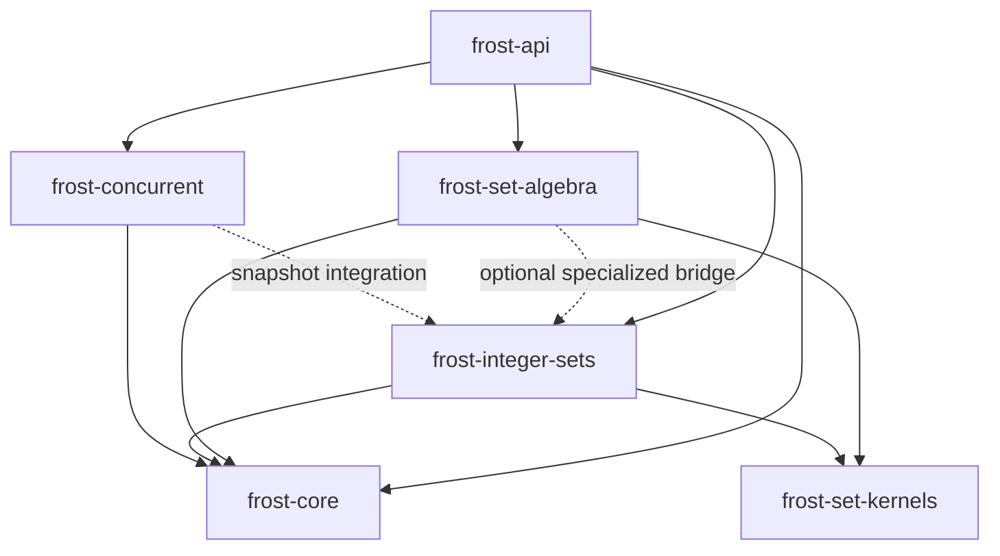

# Computed Sets Research for Frost

## Executive summary

I produced a standalone technical report centered on **Zanzibar-style computed sets, Leopard-style indexing, and algebra that can execute without eagerly materializing intermediate sets**. The report treats computed sets as executable query plans rather than containers, with separate semantics for membership, representative selection, traversal, counting, snapshots, and explicit materialization. That direction is strongly supported by Zanzibar itself: userset rewrites compose union, intersection, and exclusion; authorization checks are evaluated at consistent snapshots; and Leopard exists specifically to accelerate large/deep set computations using ordered integer sets plus an incremental update layer. citeturn376988view1turn441542view0turn441542view1

The report also connects that model to Rust implementation techniques. Rust’s `BTreeSet` demonstrates lazy ordered set-operation iterators, while `HashSet` highlights an important representative-identity issue: equal elements in an intersection can come from either input, so a Frost API that promises deterministic representative provenance must constrain planner rewrites accordingly. citeturn852766search4turn852766search5turn346310search3

For specialized storage, the report covers Roaring bitmaps, FST streams, sorted cursors, interning dictionaries, stable-base-plus-delta overlays, and differential/incremental maintenance. Roaring provides compressed integer-set representations and portable serialized formats; FST supports very large compressed byte-string sets/maps and uses lending `Streamer` semantics because efficient traversal may reuse a key buffer instead of allocating each key. citeturn105473search2turn346310search1turn105473search1turn105473search4

The design also draws on Differential Dataflow for the broader incremental-maintenance model: changes can be propagated as deltas rather than recomputing whole collections, with removals represented as negative differences. The report recommends this as an optional later execution engine rather than a prerequisite for Frost’s initial computed-set API. citeturn852766search3turn346310search0

## Deliverables

The requested report is available at the intended repository-relative path:

[**docs/research/computed-sets.md**](sandbox:/mnt/data/docs/research/computed-sets.md)

It includes the requested executive summary, Zanzibar and Leopard background, formal computed-set definitions, union/intersection/difference/symmetric-difference/join/projection semantics, representative and snapshot obligations, lazy/streaming/incremental execution, query planning, storage alternatives, specialized integer/FST bridges, Rust API sketches, crate placement, verification strategy, benchmark matrices, Mermaid diagrams, and staged implementation roadmap.

The reusable research prompt template is here:

[**docs/research/templates/research-prompt.md**](sandbox:/mnt/data/docs/research/templates/research-prompt.md)

The template captures the research question, decision context, scope, assumptions, required report layers, API sketches, benchmark requirements, preferred primary sources, verification artifacts, Mermaid diagrams, publication checklist, and a pattern for using a high-level report as the parent of narrower follow-up research.

I also packaged the repository-relative `docs/` tree for convenience:

[**frost-computed-sets-research.zip**](sandbox:/mnt/data/frost-computed-sets-research.zip)

## Core research conclusions

Zanzibar is especially relevant because its authorization model already separates stored relations from **computed usersets**. Its configuration language supports computed usersets, tuple-to-userset traversal, union, intersection, and exclusion, and its `Check` processing converts authorization questions into boolean expression trees. Zanzibar evaluates leaf work concurrently and can cancel subtrees once the overall answer has been determined, which supports Frost’s terminal-specific execution approach for operations such as `contains`, `is_empty`, and bounded enumeration. citeturn376988view1turn690562search0

Leopard provides the clearest precedent for a specialized computed-set execution tier. It represents named sets with integer set and element identifiers, evaluates expressions of union/intersection/exclusion, uses ordered integer lists such as skip lists, and reduces certain group-membership checks to non-empty set intersection. The paper describes a periodic offline index plus an online incremental layer whose timestamped updates are merged with the base snapshot during queries. citeturn441542view0turn441542view1

The report therefore recommends a Frost model in which the logical expression is independent of its physical execution:

```rust
let effective = view(&direct_viewers)
    .union(view(&group_viewers))
    .union(view(&inherited_viewers))
    .difference(view(&suspended));

if effective.try_contains(&user_id)? {
    allow();
}
```

For this membership terminal, no result container needs to exist. A planner can recursively short-circuit membership probes, use a native bitmap kernel, seek through sorted sources, or lower compatible integer IDs to a specialized representation.

For enumeration, the planner can use cursor merges when sources have compatible sorted order. For intersections with strong cardinality skew, it can scan the small side and seek or probe the large side. Leopard’s ordered-list design is a concrete production precedent for this strategy. citeturn376988view2turn441542view0

For FST-backed sets, the execution layer should not require ordinary `Iterator<Item = &T>` because the `fst` crate deliberately uses a lending `Streamer`: emitted byte keys can borrow from a reusable buffer, avoiding per-item allocation. The crate also supports combining multiple result streams with memory proportional to the number of streams. citeturn105473search1turn105473search4

For dynamic computed sets, the report distinguishes an immutable base snapshot from an ordered delta overlay. That mirrors Leopard’s architecture and gives Frost a practical incremental route before adopting a full differential-dataflow runtime. citeturn441542view1

OpenFGA and SpiceDB provide useful confirmation that computed-set semantics remain central in modern Zanzibar-inspired authorization systems. OpenFGA’s userset schema contains direct, computed, tuple-to-userset, union, intersection, and difference nodes, while SpiceDB describes permissions as computed subject sets supporting union, intersection, exclusion, and traversal operations. citeturn852766search0turn852766search2

## Proposed Frost placement

The report recommends keeping **`frost-api` as the public facade**, while placing the computed-set implementation in **`frost-set-algebra`**. Generic sorted merge and seek algorithms belong in **`frost-set-kernels`**; encoded IDs, Roaring, dense storage, and integer-specific execution belong in **`frost-integer-sets`**; foundational source capabilities remain in **`frost-core`**; and stable snapshot acquisition/publication belongs in **`frost-concurrent`**.

The intended dependency direction is captured in the report as:



The proposed capability surface builds on Frost’s existing direction rather than introducing a universal collection trait. The relevant distinctions are stable borrowed traversal through `Elements`, membership through `SetContains`, representative retrieval through `SetGet`, reconstructed-value traversal through `ValueElements`, and future optional sorted/seek capabilities. This is important because different representations have different lawful execution capabilities; for example, FST iteration has lending semantics while bitmap execution naturally works in integer-value space. citeturn105473search4turn105473search2

The report also recommends separating borrowed views from consuming operations:

```rust
view(&a).intersection(view(&b)).try_count()?;

let materialized =
    view(&a)
        .difference(view(&revoked))
        .materialize(destination)?;

let owned = a.into_union(b)?;
```

This keeps algebraic query planning distinct from representation-specific buffer reuse.

## Correctness and verification direction

A major finding is that Frost should explicitly separate **set-membership equivalence** from **observable representative equivalence**. Rust’s `HashSet` documentation notes that, when equivalent values are stored in both inputs, intersection can yield the representative from either input. citeturn346310search3 Frost can intentionally provide a stronger rule—such as left representative wins—but then optimizer rewrites must preserve that rule.

This matters especially for symmetric difference and reassociation. If equality ignores metadata, two mathematically equivalent set expressions can return different stored objects even though they contain exactly the same keys. The report therefore proposes more aggressive optimization for membership/count terminals and more conservative optimization for representative-producing iteration.

Snapshot consistency receives the same treatment. Zanzibar guarantees that authorization checks can be evaluated at a snapshot no earlier than a client-provided consistency token, and Leopard evaluates timestamped incremental updates relative to the selected query snapshot. citeturn376988view1turn441542view1 A live concurrently mutating collection should therefore not silently satisfy the same `SetSource` contract as a frozen or pinned snapshot.

The verification plan includes a finite semantic oracle, property tests, adversarial equality/representative cases, cross-plan differential testing, benchmark matrices, Miri for borrowing and cursor safety, Loom for snapshot publication and concurrency, and Kani for bounded cursor/planner invariants. Differential Dataflow’s change-oriented execution model provides useful background for later validating incremental maintenance against full recomputation. citeturn852766search3turn346310search0

## Repository status

The two files were created with the exact repository-relative paths requested and packaged in the ZIP above. I could **not commit or push them into `trumpyla/artagon-frost-collection` from this session**: the local runtime has no working network path to GitHub, and this session does not expose a write-capable GitHub connector. I therefore did not claim a repository commit that I could not actually create.

The report itself contains the complete source catalog, prioritizing the original Zanzibar paper, official OpenFGA and SpiceDB materials, Microsoft’s Differential Dataflow publication, Rust standard-library documentation, official `fst` and `roaring` crate documentation, and the Roaring format specification. citeturn105473search0turn852766search0turn852766search2turn852766search3turn852766search5turn105473search1turn105473search2turn346310search1